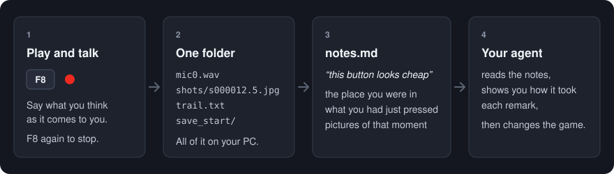

# PlayNotes

**遊びながら声で残すメモ。Unity 用、あなたの AI コーディングエージェントのために。**

   

**F8** を押して、自分のゲームを遊びながら思ったことを喋る。もう一度 F8。
PlayNotes は、あなたの声を「その瞬間にゲームが知っていたこと」と一緒に残します。ゲーム画面の写真、いた場所、直前に押した釦。全部が一つのフォルダに入り、エージェントがそのまま読める形になっています。

打たない。ゲームを離れない。「あれ、どの画面の話だっけ」が無くなる。PC の外には何も出ません。



[English](README.md)

## エージェントが受け取る物

1 回遊ぶと、言ったことが一つずつ、その瞬間と並びます。

```markdown
## 41.2-44.0 「この釦、安っぽい。なんでここにあるの」
- 場所: 作業台 / 依頼 12
- 直前の操作: (0.9 秒前) key Tab / (2.4 秒前) press "はじめる" Canvas/Menu/StartButton  @812,280
- 写真: shots/s000039.9.jpg , shots/s000041.4.jpg , shots/s000042.9.jpg , shots/s000044.4.jpg

## 58.7-60.1 「お、この注ぎ方は好き」
- 場所: 作業台 / 依頼 12 → 作業台 / 詰める
- 直前の操作: (話し始めて 1.2 秒後) press "注ぐ" Canvas/Bench/PourButton  @1040,610
- ゲームの記録: (3.1 秒前) wave: 3 began
- 写真: shots/s000057.4.jpg , shots/s000058.9.jpg , shots/s000060.4.jpg
- 長いコマ: 83 ms

## 71.0-71.6 「好き」 (?)
- 確かさ: 低い（短いか小さい声。聞き違いかもしれません）
- 場所: 作業台 / 詰める
- 直前の操作: なし
- 写真: shots/s000066.0.jpg (この一言の 5.0 秒前の絵)
```

写真の赤い輪はマウスの位置です。「これ」は、たいていマウスが乗っている物のことだからです。操作には「何秒前」が付き、クリックの `@x,y` は写真の中の位置そのままで、音声モデルが自信のない一言にはそう書かれます。当て推量で直してしまわないためです。

## 始め方

**1. 入れる。** Unity で *Window > Package Manager > + > Install package from git URL*

```
https://github.com/applemx/PlayNotes.git
```

版を固定するなら末尾にタグを付けます：`https://github.com/applemx/PlayNotes.git#v0.1.0`

**2. 遊んで喋る。** Play モードに入って **F8**。左上に赤い点が出て、声に合わせてふくらみます。遊びながら思ったことを言い、もう一度 **F8**。

**3. エージェントに渡す。** プロジェクトごとに一度だけ、*Tools > PlayNotes > Install Agent Skill (.claude)* を選びます。あとはエージェントにこう言うだけです。

> 遊びメモを見て

声を文字に起こし、写真と合わせて読み、何かを変える前に「一言ずつをこう受け取った」という一覧を返します。スキルは Claude Code 向けに書いてありますが、中身はふつうの文章の指示なので、ほかのエージェントにもそのまま渡せます。

エージェントを使わない場合は、*Tools > PlayNotes > Write New Sessions Out as Words* で文字起こしだけできます。各回のフォルダの `notes.md` は、そのまま人が読めます。

## 必要な物

| | |
|---|---|
| Unity | 2022.3 以上（Unity 6.3 で開発。2022.3 でもコンパイルと単体試験を確認） |
| 動く所 | Windows のエディタと Windows 向けビルド。ほかの環境では何もコンパイルされないので、入れたままで困りません |
| 入力 | Input System、古い Input Manager、両方、のどれでも |
| 画面 | uGUI（Text と TextMeshPro）と UI Toolkit から、押した物の名前を読みます |
| 文字起こし | [uv](https://docs.astral.sh/uv/)。初回に Python と音声モデル（約 1.6 GB）を自分で取ってきます。グラフィックカードは要りません |

## 残す物、残さない物

F8 から F8 の間だけ、それ以外の時は一切、何もしません。

- **声**：PC にある本物のマイクを全部、1 本ずつ別のファイルに。どのマイクに向かって喋っているかはプログラムには分からず、違うマイクの無音を 1 時間録るのが一番の失敗だからです。一番よく聞こえた 1 本を後で選びます。
- **ゲームの窓の写真**：数秒に 1 枚、喋っている間は速く、クリックの直後にも 1 枚。デスクトップやほかの窓は撮りません（エディタではエディタの窓になります）。
- **操作の跡**：いた場所、押した物とその字、プロジェクトが選んだ少しの鍵、カメラの位置、長くかかったコマ。
- **セーブ**：フォルダを指定すれば、前後の写し。

打った文字は残しません。パッケージに通信のコードは一行もありません。アップロードも、アカウントも、利用状況の送信もありません。文字起こしもあなたの PC の中で動きます。外とやり取りするのは、文字起こしが最初の一度だけ音声モデルを取ってくる時だけです。

音のコードは [Runtime/Microphones.cs](Runtime/Microphones.cs) の 1 ファイル、写真のコードは [Runtime/WindowShots.cs](Runtime/WindowShots.cs) の 1 ファイルです。短いので、読んで確かめてください。

## 製品には入りません

マイクを開く道具が、発売したビルドに入っていてはいけません。なので PlayNotes は、言われない限り眠っています。

- ビルドでは、exe の横に `playnotes.on` というファイルがある時だけ起きます。エディタは**開発ビルド**にだけこのファイルを書き、それ以外のビルドからは取り除きます（設定で変えられます）。ファイルを消せば、そのビルドに PlayNotes はありません。
- コードごとビルドから抜くには、*Player Settings > Scripting Define Symbols* に `PLAYNOTES_DISABLED` を足します。`PlayNotes.Recorder` を呼んでいる所はそのままコンパイルでき、何もしなくなります。
- `playnotes.on` のあるビルドを人に渡すと、その人が鍵を押した時にその人の声を録ります。先に伝えてください。

## 誰も待たせません

PlayNotes は、押すのを待つダイアログを一つも出しません。ゲームの中でも、エディタでも、ビルドの時でも。メニューの返事は Console の一行と、消えていく通知です。エディタを動かしているのは人の手とは限らず、スクリプトや AI エージェントのこともあります。押すのを待つダイアログは、それらをいつまでも待たせてしまうからです（パッケージの試験の一つが、これを守らせています）。

## ゲームのことを教える（任意）

コードなしで動きます。数行足すと、写真では分からないことをゲームが言えます。

```csharp
// いる場所を数語で（無ければシーンの名前が入ります）
PlayNotes.Recorder.Where = () => $"{levelName} / {screenName}";

// あとで読む時に知りたい出来事
PlayNotes.Recorder.Mark("wave", "7 began");

// 毎回セーブを写す。その一言が出た状態を再現できます
PlayNotes.Recorder.AddSnapshotFolder("Saves");
```

試験や道具からは、鍵なしで始めたり止めたりできます：`Recorder.Begin()`、`Recorder.Stop()`、`Recorder.IsRecording`、`Recorder.SessionFolder`、イベント `Began` と `Stopped`。Package Manager の *Hooks* サンプルに、上の数行を入れた部品があります。

## 設定

*Edit > Project Settings > PlayNotes*。中身は `ProjectSettings/PlayNotesSettings.json` で、プロジェクトと一緒に版管理に入ります。

| 設定 | 既定 | |
|---|---|---|
| Key | `F8` | 始めると止める。空にするとコードからだけ |
| Name the key at launch | 入 | 起動して数秒、鍵の名前を画面に出す |
| Keys noted in the trail | Escape Enter Tab Space E 1〜9 | ここにある鍵だけを書き留める |
| Picture every (speaking / quiet) | 1.5 秒 / 6 秒 | |
| Language spoken | 自動 | `ja` や `en` |
| The game's own words | なし | 音声モデルが知らない、ゲームの名前や用語。書き起こしが一番良くなる設定 |
| Sessions folder | `persistentDataPath/PlayNotes` | |
| Folders copied with each session | なし | ふつうはセーブの場所 |
| Sound inputs to leave alone | なし | ループバックの類は初めから外してあります |
| Write `playnotes.on` beside | 開発ビルド | 全部のビルド、書かない、も選べます |

## 1 回分のフォルダ

```
20261112-080012/
  trail.txt            起きたこと：秒 <tab> 種類 <tab> 言葉
  mic0.wav             声。マイク 1 本に 1 ファイル
  shots/s000012.5.jpg  12.5 秒の時のゲームの窓
  save_start/          セーブの写し（前と後）
  save_end/
  words.txt            言ったこと（notes.py が書く）
  notes.md             一言ずつをその瞬間と並べた物（notes.py が書く）
```

書式は決まっていて、[Documentation~/session-format.md](Documentation~/session-format.md) に書いてあります。自分の道具で読むことも、文字起こしを別の物に替えることもできます。

`Transcribe~/notes.py` は手でも動かせます。

```
uv run notes.py "<回が並ぶフォルダ>" --check              動かすと何が起きるかを言うだけ（何も取らず、書かない）
uv run notes.py "<回が並ぶフォルダ>"                      まだ起こしていない回を全部
uv run notes.py "<1 回分>" --delete-audio                 その回の録音だけを消す（文字は残る）
uv run notes.py "<回が並ぶフォルダ>" --model small        小さく速いモデルで
```

## 困った時

**「まだ声が届いていません」が消えない。** 喋っているマイクが消音になっているか、Windows がデスクトップアプリにマイクを使わせていません（*設定 > プライバシーとセキュリティ > マイク*）。その回の `trail.txt` に、見つかった入力と開けなかった入力が全部書いてあります。

**最初の文字起こしがとても長い。** 音声モデル（既定の物で約 1.6 GB）を取ってきています。一度だけです。進み具合は表示されます。回線が遅い時は `--model small`（約 0.5 GB）から始めてください。2 回目からは数秒で始まり、通信も要りません。

**ゲームの言葉が違う字になる。** *The game's own words* に、間を空けて並べてください。人や場所や道具の名前は、音声モデルが聞いたことのない言葉です。

**写真がエディタ全体になる。** エディタでは窓がエディタの物だからです。ビルドならゲームだけが写ります。

**ゲームが重くなる？** 音と写真は別のスレッドで取ります。写真 1 枚につき、1 コマが 10 ms ほど長くなります（元になったゲームで測った値）。黙っている間は 6 秒に 1 枚まで減らしているのはそのためです。

**Mac、Linux、ゲーム機は？** まだです。そこでは何もコンパイルされないので、ほかの環境の人と共有しているプロジェクトが壊れることはありません。

**遊んだ人や外のテスターから報告を集めたい。** それは別の道具の仕事です（入力欄、同意、サーバーが要ります）。PlayNotes は、あなたと、あなたの机にいる人のための物です。

## 生まれた所

作りかけの一本のゲームのために作りました。「2 枚目の画面の釦が安っぽい」と打つために、遊ぶ手を止めたくなかったからです。エージェント用スキルにある決まり（一言は気持ちであって命令ではない、作る前に一覧を返す、言われた不具合は直す前に確かめる）は、100 回あまり使って分かったことです。

## ライセンス

[MIT](LICENSE.md)。文字起こしは [faster-whisper](https://github.com/SYSTRAN/faster-whisper) と Whisper のモデルを使います。初めて動かす時に取ってくる物で、このパッケージには含まれません。[Third Party Notices](Third%20Party%20Notices.md) を見てください。
