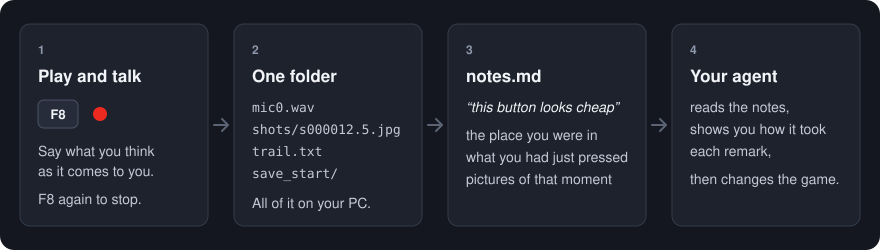

# PlayNotes

**Voice playtest notes for Unity, for your AI coding agent.**

   

Press **F8**, play your game and say what you think. Press F8 again.
PlayNotes has kept your voice together with what the game knew at that moment: pictures of the game window, the place you were in, the button you had just pressed. It is all in one folder, written so that your agent can read it.

No typing, no leaving the game, no "which screen was that again". Nothing leaves your PC.



[日本語の説明はこちら](README.ja.md)

## What your agent gets

After a session, each thing you said stands beside its moment:

```markdown
## 41.2-44.0 "this button looks cheap, and why is it over here"
- place: Workbench / order 12
- just before: (0.9 s before) key Tab / (2.4 s before) press "Start" Canvas/Menu/StartButton  @812,280
- pictures: shots/s000039.9.jpg , shots/s000041.4.jpg , shots/s000042.9.jpg , shots/s000044.4.jpg

## 58.7-60.1 "ooh, I like how this pours"
- place: Workbench / order 12 → Workbench / filling
- just before: (1.2 s into the remark) press "Pour" Canvas/Bench/PourButton  @1040,610
- the game noted: (3.1 s before) wave: 3 began
- pictures: shots/s000057.4.jpg , shots/s000058.9.jpg , shots/s000060.4.jpg
- long frames: 83 ms

## 71.0-71.6 "nice" (?)
- unsure: very short or faint, may be misheard
- place: Workbench / filling
- just before: nothing
- pictures: shots/s000066.0.jpg (taken 5.0 s before the remark)
```

A red ring in the pictures marks the mouse pointer, because "this" is so often what it rests on. Each thing done carries how long before the remark it was, a click's `@x,y` is its place in the picture, and a remark the speech model was unsure of says so, so that nobody acts on a guess.

## Quick start

**1. Install.** In Unity: *Window > Package Manager > + > Install package from git URL*

```
https://github.com/applemx/PlayNotes.git
```

To stay on one version, add its tag: `https://github.com/applemx/PlayNotes.git#v0.1.0`

**2. Play and talk.** Enter Play mode and press **F8**. A red dot appears in the corner and swells with your voice. Play, say what you think, press **F8** again.

**3. Hand it to your agent.** Once for each project, choose *Tools > PlayNotes > Install Agent Skill (.claude)*. Then tell your agent:

> read my play notes

It writes your voice out as words, reads them with the pictures, and gives you back a list of how it took each remark before it changes anything. The skill is written for Claude Code; its text is plain instructions, so it can be handed to another agent as they are.

No agent? *Tools > PlayNotes > Write New Sessions Out as Words* does the writing-out, and `notes.md` in each session folder reads well by itself.

## Requirements

| | |
|---|---|
| Unity | 2022.3 or newer (developed on Unity 6.3; compiled and unit-tested on 2022.3 as well) |
| Platform | Windows: the editor, and Windows builds. On other platforms the package compiles to nothing, so it is safe to leave installed |
| Input | the Input System package, the old Input Manager, or both |
| Interface | uGUI (Text and TextMeshPro) and UI Toolkit are read for the names of what you click |
| For writing the voice out | [uv](https://docs.astral.sh/uv/). It fetches Python and the speech model by itself the first time (about 1.6 GB). A graphics card is not needed |

## What it records, and what it does not

Between F8 and F8, and at no other time:

- **Your voice**, from every real microphone of the PC, each to its own file. Which microphone you speak into is not something a program can know, and an hour of silence from the wrong one would be the worst failure here. The clearest one is picked afterwards.
- **Pictures of the game's own window**: one every few seconds, faster while you speak, and one just after each click. Never the desktop, never another window. (In the editor, the editor's window.)
- **A trail**: where you were, what you clicked and the words on it, the few keys the project chose to watch, the camera's position, frames that took too long.
- **Your save files**, before and after, if you name their folder.

It does not record the keys you type. The package has no network code at all: nothing is uploaded, there is no account and no telemetry. Speech-to-text runs on your PC too; the one thing that ever touches the network is that script fetching its speech model, once.

The sound code is one file, [Runtime/Microphones.cs](Runtime/Microphones.cs), and the picture code is one file, [Runtime/WindowShots.cs](Runtime/WindowShots.cs). Read them; they are short.

## It does not ship with your game

A tool that opens a microphone has no business in a released build, so PlayNotes is asleep unless told otherwise:

- In a build it wakes only if a file named `playnotes.on` stands beside the exe. The editor writes that file for **development builds** and takes it away from any other build (changeable in the settings). Delete the file and that build has no PlayNotes.
- To leave the code out of a build altogether, add `PLAYNOTES_DISABLED` to *Player Settings > Scripting Define Symbols*. Your calls to `PlayNotes.Recorder` still compile; they do nothing.
- If you give a build with `playnotes.on` to someone else, it will record their voice when they press the key. Tell them first.

## It never makes anyone wait

Nothing in PlayNotes opens a dialog with a button to press: not in the game, not in the editor, not during a build. Its menu items answer with a line in the Console and a notice that fades. An editor is as often driven by a script or an AI agent as by a hand on the mouse, and a dialog that waits for a click leaves those waiting for ever. (A test in the package keeps it that way.)

## Tell it about your game (optional)

PlayNotes works with no code. A few lines let the game say what a picture cannot:

```csharp
// where the player is, in a few words (otherwise the scene's name is used)
PlayNotes.Recorder.Where = () => $"{levelName} / {screenName}";

// anything worth knowing when the remark is read later
PlayNotes.Recorder.Mark("wave", "7 began");

// copy the save files with every session, so a remark can be reproduced
PlayNotes.Recorder.AddSnapshotFolder("Saves");
```

Tests and tools can start and stop a session without the key: `Recorder.Begin()`, `Recorder.Stop()`, `Recorder.IsRecording`, `Recorder.SessionFolder`, and the events `Began` and `Stopped`. The *Hooks* sample in the Package Manager has the lines above in a component.

## Settings

*Edit > Project Settings > PlayNotes*. They are kept in `ProjectSettings/PlayNotesSettings.json`, which goes into version control with the rest of the project.

| Setting | Default | |
|---|---|---|
| Key | `F8` | Starts and stops a session. Empty: from code only |
| Name the key at launch | on | Shows the key on screen for a few seconds |
| Keys noted in the trail | Escape Enter Tab Space E 1-9 | Only these are written down |
| Picture every (speaking / quiet) | 1.5 s / 6 s | |
| Language spoken | detected | A code such as `ja` or `en` |
| The game's own words | none | Names and terms a speech model has never met. The setting that most improves what is written out |
| Sessions folder | `persistentDataPath/PlayNotes` | |
| Folders copied with each session | none | The save files, usually |
| Sound inputs to leave alone | none | Loopback devices are left alone already |
| Write `playnotes.on` beside | development builds | or all builds, or never |

## The session folder

```
20261112-080012/
  trail.txt            what happened: seconds <tab> kind <tab> words
  mic0.wav             your voice, one file for each microphone
  shots/s000012.5.jpg  the game window at second 12.5
  save_start/          your save files, before and after
  save_end/
  words.txt            what was said (written by notes.py)
  notes.md             each remark beside its moment (written by notes.py)
```

The layout is fixed and written down in [Documentation~/session-format.md](Documentation~/session-format.md), so you can read it with tools of your own, or swap the speech-to-text step for another.

`Transcribe~/notes.py` can be run by hand:

```
uv run notes.py "<the sessions folder>" --check           what a run would do; nothing is fetched or written
uv run notes.py "<the sessions folder>"                   every session not yet written out
uv run notes.py "<one session>" --delete-audio            delete that session's recordings (its words stay)
uv run notes.py "<the sessions folder>" --model small     a smaller, faster model
```

## Questions

**"No voice heard yet" stays on the screen.** The microphone you are speaking into is muted, or Windows is not letting desktop apps use it (*Settings > Privacy & security > Microphone*). The session's `trail.txt` lists every input that was found and any that would not open.

**The first writing-out takes very long.** It is fetching the speech model (about 1.6 GB for the default one), once. The progress is shown; on a slow line, start with `--model small` (about 0.5 GB). From the second run on it starts in seconds and needs no network.

**The game's own words come out wrong.** Put them into *The game's own words*, with spaces between them. Names of characters, places and tools are what a general speech model has never met.

**The pictures show the whole editor.** In the editor the window is the editor's. Builds give pictures of the game alone.

**Does it slow the game down?** Sound and pictures are taken on threads of their own. Each picture makes one frame about 10 ms longer (measured in the game it was built for), which is why the pace drops to one every six seconds while you are quiet.

**Mac? Linux? Consoles?** Not yet. The package compiles to nothing there, so a project shared with people on other systems is not broken by it.

**I want reports from players and outside testers.** That is a different tool: one with a form, consent and a server. PlayNotes is for you and the people at your desk.

## Where this came from

It was built for one game in the making, by a developer who did not want to stop playing to type "the button on the second screen looks cheap". The rules in the agent skill (a remark is a reaction and not an order; give the list back before building; check a claimed bug before fixing it) are what a hundred-odd sessions taught.

## License

[MIT](LICENSE.md). The speech-to-text step uses [faster-whisper](https://github.com/SYSTRAN/faster-whisper) and a Whisper model, fetched when first run and not part of this package: see [Third Party Notices](Third%20Party%20Notices.md).
